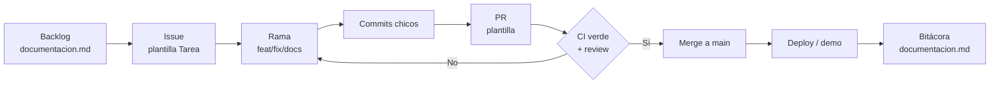

# 18 — Workflow del equipo

> **Objetivo:** que cinco personas puedan trabajar en paralelo sin pisarse, con un demo que siempre funcione.
> **Herramientas:** GitHub Issues/PRs, `make`, Ruff, Pytest, pre-commit, GitHub Actions, Typst.

---

## 1. Principios

1. **`main` siempre funciona.**
2. **Un issue = una rama = un PR.**
3. **PRs chicos** (<300 líneas) y con review rápido.
4. **Demo primero:** si no se puede mostrar, no cuenta.
5. **Datos con contrato:** sin dataset/API/campos/fallback, no entra.
6. **Documentar es trabajar.**
7. **Corte de alcance a T-12 h.**

---

## 2. Flujo completo



### Paso a paso
1. Elegí una tarea del [backlog](14-backlog.md).
2. Abrí un issue con la plantilla **Tarea** (incluye contrato de datos).
3. Creá la rama: `feat/p0-07-endpoint-salud`.
4. Hacé commits chicos.
5. Abrí el PR con la plantilla.
6. Esperá CI verde + 1 review.
7. Mergeá.
8. Actualizá la bitácora.

---

## 3. Ramas y commits

### Ramas

El equipo trabaja con **4 niveles**. Nadie escribe directo en `main`.

```text
main        producción. Solo recibe merges desde staging. Siempre funciona.
  ↑
staging     puente de integración. Junta develop + ramas en revisión y se prueba el demo completo.
  ↑
develop     desarrollo. Integración diaria del equipo.
  ↑
andy / david / samuel / jorge / leo    rama personal de cada integrante
```

| Rama | Quién escribe | Sale hacia | Regla |
|---|---|---|---|
| `main` | nadie directo | — | Solo merge desde `staging` + tag de versión |
| `staging` | el que integra (Andy) | `main` | Demo completo verificado; si falla, no pasa |
| `develop` | merges de PRs | `staging` | Integración diaria; puede estar roja por horas, no por días |
| `andy`, `david`, `samuel`, `jorge`, `leo` | su dueño | `develop` | Trabajo libre; nadie más commitea acá |

### Ciclo de trabajo

```bash
git checkout develop && git pull
git checkout andy            # tu rama
git merge develop            # traer lo último antes de empezar
# ... trabajás, commiteás ...
git push origin andy

# PR: andy -> develop  (review de 1 persona + CI verde)
```

Promoción:
```text
andy/david/... --PR--> develop --PR--> staging --PR--> main
```

- **develop → staging:** cuando el demo funciona de punta a punta.
- **staging → main:** cuando el demo corre sin internet, el video de respaldo existe y el pitch está listo. Ahí se tagea (`v0.1.0-demo`).

### Nombres de commits y ramas

Las ramas personales pueden tener sub-ramas para algo grande:

```text
andy                    trabajo diario
andy/endpoint-salud     feature puntual (opcional, se borra al mergear)
fix/timeout-api         bug urgente (desde develop)
```

Commits:
```text
add endpoint de salud
fix timeout de API
docs workflow
data agregar catálogo de ejemplo
```

### Regla
Si el commit necesita “y” (“agrega X y arregla Y”), son dos commits.

---

## 3.1. Si alguien se equivoca

El puente existe justamente para que un error **no llegue a producción**.

| Situación | Qué hacer | Comando |
|---|---|---|
| Error en tu rama, sin push | Deshacer el último commit | `git reset --hard HEAD~1` |
| Error en tu rama, con push | Revertir sin borrar historia | `git revert <sha>` + push |
| Rompiste `develop` | Revertir el merge | `git revert -m 1 <sha-del-merge>` |
| Rompiste `staging` | Revertir ahí; `main` sigue sano | `git checkout staging && git revert <sha>` |
| Llegó a `main` (caso raro) | Hotfix directo y tag nuevo | `fix/...` → `main` → merge back a `develop` y `staging` |
| Perdiste trabajo | Recuperar desde reflog | `git reflog` y `git checkout -b rescate <sha>` |
| Querés ver qué cambió | Comparar ramas | `git log --oneline develop..andy` |

**Reglas de oro ante un error:**
1. **Avisar en el canal antes de arreglar.** Nadie más debe mergear mientras tanto.
2. **Nunca `push --force` sobre `develop`, `staging` ni `main`.** Solo en tu rama personal y avisando.
3. **Revertir, no reescribir.** En ramas compartidas la historia se agrega, no se borra.
4. **Si `main` está roto:** arreglar primero, preguntar después.

---

## 4. Issues y etiquetas

| Etiqueta | Significado |
|---|---|
| `P0` | Imprescindible para el demo |
| `P1` | Diferenciador |
| `P2` | Bonus |
| `blocked` | Esperando algo/alguién |
| `data` | Pipeline/datos |
| `backend` | API |
| `frontend` | UI |
| `science` | Validación/QA |
| `pitch` | Video/slides |
| `docs` | Documentación |
| `decision` | ADR/decisión |

**Regla:** un issue tiene **una** prioridad y **un** dueño.

---

## 5. Pull Requests

- Título claro: `feat: endpoint de salud con estado del servicio`.
- Descripción con: qué, por qué, cómo probarlo, evidencia.
- Checklist de la plantilla completo.
- Si toca datos: contrato de datos.
- Si toca UI: captura/GIF.
- Si toca API: comando + salida.

**Review SLA:** 15 min durante el hackathon. Si nadie revisa en 15 min, avisar en el canal.

---

## 6. Datos

### Pipeline
```text
fuente NASA → script reproducible → caché local → JSON/API → UI
```

### Reglas
- `data/cache/` **no** se commitea.
- `data/samples/` sí (CSV/JSON chicos).
- Cada dataset tiene `manifest.json` con fuente, fecha y versión.
- Cada script es reproducible con un comando.
- Si la API falla: usar caché o un sample local (fallback declarado).
- Documentar el **contrato de datos** de cada feature.

### Comandos
```bash
make check          # ruff + pytest
make guides         # PDF de las guías
```

---

## 7. Demo y freeze

### Antes del freeze
- Precomputar los datos del demo.
- Verificar que el demo funcione **sin internet**.
- Grabar un video de respaldo.

### Freeze (domingo 12:00)
- No se agregan features.
- Solo bugs, pulido, pitch y submission.
- `main` queda en estado demo.

### Ensayos
- 16:00 — ensayo 1.
- 18:00 — ensayo 2.
- 20:00 — submission.
- 22:00 — buffer.

---

## 8. Rutina diaria

| Hora | Qué |
|---|---|
| 09:00 | Standup (10 min): qué hice, qué sigue, qué me bloquea |
| 09:15 | Cada uno toma un issue P0 |
| 11:00 | Checkpoint rápido en el canal |
| 13:00 | Almuerzo |
| 15:00 | Checkpoint + review de PRs |
| 18:00 | Integración: ¿el demo funciona? |
| 21:00 | Standup + actualizar bitácora |
| 23:00 | Dormir (turnos) |

---

## 9. CI/CD

### CI (GitHub Actions)
- **Python:** Ruff + Pytest.
- **Frontend:** build si existe `package.json`.
- **Guías:** compila Typst y sube artifact.

### Local
```bash
make check   # lint + tests
make guides  # PDF/PNG
```

### Deploy (cuando exista)
- Frontend: Vercel.
- Backend: Render/Fly.io.
- O todo en FastAPI con `StaticFiles`.
- Link público, sin login.

---

## 10. Herramientas

| Herramienta | Para qué | Comando |
|---|---|---|
| `make` | Tareas | `make help` |
| Ruff | Lint/format | `make lint`, `make format` |
| Pytest | Tests | `make test` |
| pre-commit | Hooks | `pre-commit install` |
| Typst | Guías visuales | `make guides` |
| GitHub Actions | CI | push/PR |

Detalle en [19-herramientas.md](19-herramientas.md).

---

## 11. Decisiones (ADR corto)

Toda decisión importante se registra en:
1. Un issue con etiqueta `decision`.
2. Una fila en el **Decision Log** de `documentacion.md`.

Formato:
```text
Contexto → Opciones → Decisión → Consecuencias
```

---

## 12. Qué NO hacer

- ❌ Trabajar en `main`.
- ❌ Mergear sin review.
- ❌ Commitear `.env`, `data/cache/`, `*.fits`.
- ❌ Agregar features después del freeze.
- ❌ Prometer datos que no tenemos.
- ❌ Decir “descubrimos” sin validación.
- ❌ Dormir 0 horas.
