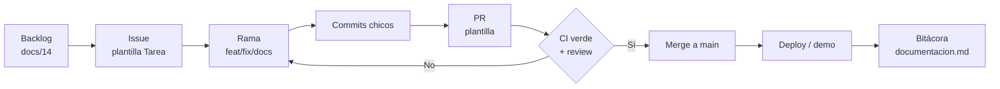

# 18 — Workflow del equipo

> **Objetivo:** que cinco personas puedan trabajar en paralelo sin pisarse, con un demo que siempre funcione.
> **Herramientas:** GitHub Issues/PRs, `make`, Ruff, Pytest, pre-commit, GitHub Actions, Typst.

---

## 1. Principios

1. **`main` siempre funciona.**
2. **Un issue = una rama = un PR.**
3. **PRs chicos** (<300 líneas) y con review rápido.
4. **Demo primero:** si no se puede mostrar, no cuenta.
5. **Datos con contrato:** sin dataset/API/campos/fallback, no entra.
6. **Documentar es trabajar.**
7. **Corte de alcance a T-12 h.**

---

## 2. Flujo completo



### Paso a paso
1. Elegí una tarea del [backlog](14-backlog.md).
2. Abrí un issue con la plantilla **Tarea** (incluye contrato de datos).
3. Creá la rama: `feat/p0-07-blink-player`.
4. Hacé commits chicos.
5. Abrí el PR con la plantilla.
6. Esperá CI verde + 1 review.
7. Mergeá.
8. Actualizá la bitácora.

---

## 3. Ramas y commits

### Ramas
```text
feat/…    nueva funcionalidad
fix/…     bug
docs/…    documentación
data/…    pipeline/caché
pitch/…   video/slides
chore/…   CI, tooling
```

### Commits
```text
add SIA2 query
fix cutout timeout
docs workflow
data precompute wise0855
```

### Regla
Si el commit necesita “y” (“agrega X y arregla Y”), son dos commits.

---

## 4. Issues y etiquetas

| Etiqueta | Significado |
|---|---|
| `P0` | Imprescindible para el demo |
| `P1` | Diferenciador |
| `P2` | Bonus |
| `blocked` | Esperando algo/alguién |
| `data` | Pipeline/datos |
| `backend` | API/FITS |
| `frontend` | UI |
| `science` | Validación/QA |
| `pitch` | Video/slides |
| `docs` | Documentación |
| `decision` | ADR/decisión |

**Regla:** un issue tiene **una** prioridad y **un** dueño.

---

## 5. Pull Requests

- Título claro: `feat: blink player con slider de épocas`.
- Descripción con: qué, por qué, cómo probarlo, evidencia.
- Checklist de la plantilla completo.
- Si toca datos: contrato de datos.
- Si toca UI: captura/GIF.
- Si toca API: comando + salida.

**Review SLA:** 15 min durante el hackathon. Si nadie revisa en 15 min, avisar en el canal.

---

## 6. Datos

### Pipeline
```text
SIA2 → CSV → cutouts → FITS → PNG/manifest → caché → frontend
```

### Reglas
- `data/cache/` **no** se commitea.
- `data/samples/` sí (CSV chicos).
- Cada target tiene `manifest.json`.
- Cada script es reproducible con un comando.
- Si IRSA falla: usar CSV/S3/caché.
- Documentar el **contrato de datos** de cada feature.

### Comandos
```bash
make precompute     # WISE 0855 + Barnard's Star
make backend        # API
```

---

## 7. Demo y freeze

### Antes del freeze
- Precomputar 5 targets.
- Verificar que el demo funcione **sin internet**.
- Grabar un video de respaldo.

### Freeze (domingo 12:00)
- No se agregan features.
- Solo bugs, pulido, pitch y submission.
- `main` queda en estado demo.

### Ensayos
- 16:00 — ensayo 1.
- 18:00 — ensayo 2.
- 20:00 — submission.
- 22:00 — buffer.

---

## 8. Rutina diaria

| Hora | Qué |
|---|---|
| 09:00 | Standup (10 min): qué hice, qué sigue, qué me bloquea |
| 09:15 | Cada uno toma un issue P0 |
| 11:00 | Checkpoint rápido en el canal |
| 13:00 | Almuerzo |
| 15:00 | Checkpoint + review de PRs |
| 18:00 | Integración: ¿el demo funciona? |
| 21:00 | Standup + actualizar bitácora |
| 23:00 | Dormir (turnos) |

---

## 9. CI/CD

### CI (GitHub Actions)
- **Python:** Ruff + Pytest.
- **Frontend:** build si existe `package.json`.
- **Guías:** compila Typst y sube artifact.

### Local
```bash
make check   # lint + tests
make guides  # PDF/PNG
```

### Deploy (cuando exista)
- Frontend: Vercel.
- Backend: Render/Fly.io.
- O todo en FastAPI con `StaticFiles`.
- Link público, sin login.

---

## 10. Herramientas

| Herramienta | Para qué | Comando |
|---|---|---|
| `make` | Tareas | `make help` |
| Ruff | Lint/format | `make lint`, `make format` |
| Pytest | Tests | `make test` |
| pre-commit | Hooks | `pre-commit install` |
| Typst | Guías visuales | `make guides` |
| GitHub Actions | CI | push/PR |
| FastAPI | Backend | `make backend` |

Detalle en [19-herramientas.md](19-herramientas.md).

---

## 11. Decisiones (ADR corto)

Toda decisión importante se registra en:
1. Un issue con etiqueta `decision`.
2. Una fila en el **Decision Log** de `documentacion.md`.

Formato:
```text
Contexto → Opciones → Decisión → Consecuencias
```

---

## 12. Qué NO hacer

- ❌ Trabajar en `main`.
- ❌ Mergear sin review.
- ❌ Commitear `.env`, `data/cache/`, `*.fits`.
- ❌ Agregar features después del freeze.
- ❌ Prometer datos que no tenemos.
- ❌ Decir “descubrimos” sin validación.
- ❌ Dormir 0 horas.
