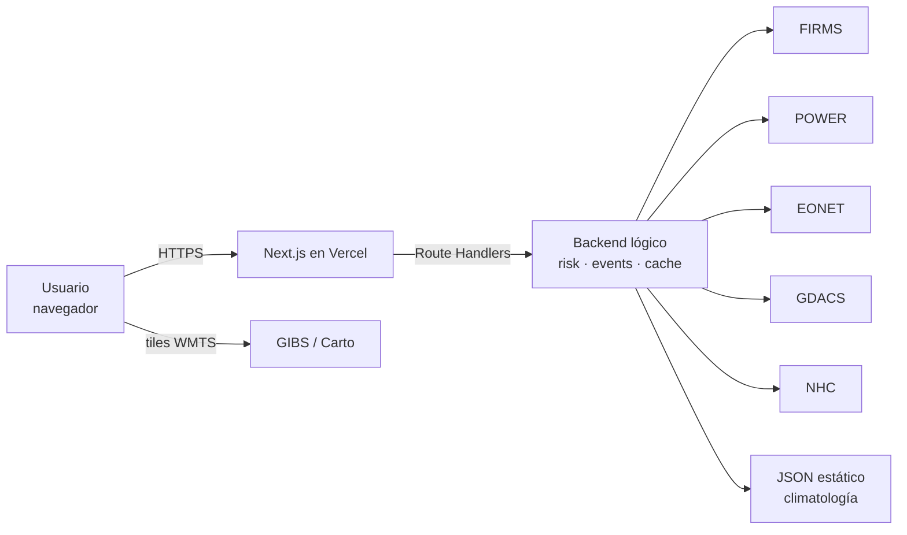
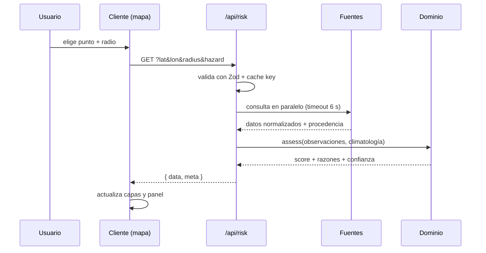

# Arquitectura de la app

> **Estado:** parcial · es el diseño inicial; lo que corre hoy se describe en [`producto/alertas.md`](../producto/alertas.md) y [`fuentes.md`](fuentes.md).

> **Stack decidido:** Next.js (App Router) + TypeScript + Tailwind CSS + MapLibre GL.
> **Alcance:** un hazard por MVP; la arquitectura queda preparada para sumar otros.
> Este documento define **cómo se estructura** el sistema. El flujo de producto y el plan de
> 12 h están en [`23-plan-app.md`](../archivo/plan-app-inicial.md); los datos, en
> [`22-investigacion-desastres.md`](../investigacion/desastres.md).

---

## 1. Contexto y límites

La app responde una sola pregunta: **“¿qué peligro hay cerca de mi ubicación, cuándo llega y
con qué confianza?”**.

Límites que la arquitectura debe respetar:

- **Sin base de datos en el MVP.** Climatología en JSON versionado; lo demás se consulta y cachea.
- **Sin autenticación.** Ubicación por URL; no se guardan cuentas ni historiales.
- **Un hazard por MVP.** El adaptador de hazard es una interfaz; los demás son stubs.
- **Las claves nunca llegan al navegador.** Todo lo externo pasa por el servidor de Next.
- **La app informa, no alerta.** Siempre muestra fuente, hora y enlace a la agencia oficial.
- **Falla suave.** Si una API cae, se muestra el último dato con aviso, no una pantalla rota.

---

## 2. Vista de sistema



**Un solo deploy.** No hay backend separado: las rutas API de Next son el BFF. Esto reduce
infraestructura, esconde claves y permite cachear en el mismo origen.

---

## 3. Capas y responsabilidades

| Capa | Vive en | Responsabilidad | No debe |
|---|---|---|---|
| **Presentación** | `app/`, `components/` | Mapa, panel, estados, accesibilidad | Llamar APIs externas |
| **BFF / API** | `app/api/**/route.ts` | Validar query, cachear, orquestar, responder `meta` | Contener reglas de negocio |
| **Dominio** | `lib/risk/`, `lib/stats.ts`, `lib/geo.ts` | Score, razones, confianza, percentiles | Conocer el formato de FIRMS |
| **Integración** | `lib/sources/` | Timeout, reintento, normalización, procedencia | Decidir el riesgo |
| **Datos** | `web/data/` | Climatología precomputada y fallback | Datos pesados o secretos |

**Regla de oro:** el dominio solo ve tipos propios (`HazardEvent`, `Observation`), nunca el JSON
crudo de una agencia. Si mañana cambia FIRMS, solo se toca `lib/sources/firms.ts`.

---

## 4. Estructura objetivo

```text
web/
├── app/
│   ├── layout.tsx
│   ├── page.tsx                     # shell: mapa + panel
│   └── api/
│       ├── risk/route.ts
│       ├── events/route.ts
│       ├── climatology/route.ts
│       └── health/route.ts
├── components/
│   ├── map/
│   │   ├── MapShell.tsx             # wrapper cliente + dynamic
│   │   ├── MapCanvas.tsx            # instancia MapLibre
│   │   ├── layers.ts                # definición declarativa de capas
│   │   └── Legend.tsx
│   ├── risk/RiskPanel.tsx
│   ├── location/SearchBox.tsx
│   ├── location/RadiusPicker.tsx
│   ├── events/EventCard.tsx
│   └── ui/
├── lib/
│   ├── types.ts
│   ├── env.ts                       # server-only
│   ├── geo.ts
│   ├── stats.ts
│   ├── cache.ts
│   ├── risk/
│   │   ├── index.ts                 # HazardAdapter
│   │   └── fire.ts                  # MVP
│   └── sources/
│       ├── firms.ts
│       ├── power.ts
│       ├── eonet.ts
│       ├── gdacs.ts
│       ├── nhc.ts
│       └── http.ts                  # fetch con timeout y reintento
├── data/
│   ├── fire-climatology.json
│   └── demo-fallback.json
├── scripts/
│   └── build-climatology.ts
├── tests/
├── public/
├── package.json
└── next.config.ts
```

**Por qué `web/` y no la raíz:** el repo también tiene Typst, Ruff y Pytest. Aislar npm evita
que las herramientas se pisen y permite configurar Vercel con `root directory = web`.

---

## 5. Flujo de una consulta



Pasos concretos:

1. El cliente pide a `/api/risk` (SWR, debounce al mover el mapa).
2. La ruta valida y normaliza la clave: `risk:fire:39.47:-0.38:25`.
3. Consulta en paralelo con `Promise.allSettled`; una fuente caída no bloquea el resto.
4. El adaptador calcula el score y devuelve `reasons`, `confidence` y `sources`.
5. La respuesta incluye `meta.cached`, `meta.updatedAt` y `meta.fallback`.
6. El cliente actualiza `source.setData()` y el panel; no recarga el mapa.

**Errores:** si falla la fuente principal, se responde 200 con `fallback: true` y el último JSON
válido. Solo se responde 4xx/5xx si no hay ningún dato ni fallback.

---

## 6. Contratos

```ts
export type Hazard = "fire" | "cyclone" | "flood";
export type LatLon = { lat: number; lon: number };
export type BBox = [west: number, south: number, east: number, north: number];

export type HazardEvent = {
  id: string;
  hazard: Hazard;
  title: string;
  geometry: GeoJSON.Geometry;
  startedAt: string;
  updatedAt: string;
  severity?: number;                // 0..1
  source: "FIRMS" | "EONET" | "GDACS" | "NHC";
  sourceUrl: string;
  distanceKm?: number;
};

export type RiskAssessment = {
  hazard: Hazard;
  level: "info" | "low" | "moderate" | "high" | "extreme";
  score: number;                    // 0..100
  reasons: { label: string; value: string; weight: number }[];
  confidence: "low" | "medium" | "high";
  updatedAt: string;
  sources: { name: string; url: string; latency: string }[];
  officialUrl?: string;
  disclaimer: string;
};

export type ApiMeta = {
  cached: boolean;
  updatedAt: string;
  latencySeconds: number;
  fallback: boolean;
};

export type ApiResponse<T> = { data: T; meta: ApiMeta };
```

| Ruta | Query | Respuesta |
|---|---|---|
| `GET /api/risk` | `lat, lon, radius, hazard` | `ApiResponse<RiskAssessment>` |
| `GET /api/events` | `hazard, bbox, days` | `ApiResponse<HazardEvent[]>` |
| `GET /api/climatology` | `lat, lon, hazard` | `ApiResponse<Climatology>` |
| `GET /api/health` | — | estado de fuentes y claves |

**Validación:** Zod en el borde. `lat` −90..90, `lon` −180..180, `radius` 1..100 km,
`hazard` enum, `bbox` ordenado y con tamaño máximo. Error 400 con `{ error, detail }`.

---

## 7. Motor de riesgo

```ts
export interface HazardAdapter {
  id: Hazard;
  getEvents(bbox: BBox, days: number): Promise<HazardEvent[]>;
  assess(point: LatLon, radiusKm: number): Promise<RiskAssessment>;
}
```

El MVP implementa `fire.ts`:

```text
score = 100 × (
  0.40 × proximidad
+ 0.25 × clima de fuego
+ 0.20 × sequedad
+ 0.15 × historial
)
```

- Cada bloque se normaliza 0..1 con una función pura y testeable.
- `reasons` muestra los 3 aportes más altos con su valor real.
- `confidence` baja si el dato tiene > 12 h, si falta una fuente o si es fallback.
- **Sin dato principal no hay score.** Se devuelve `level: "info"` y una razón “sin datos”.

Los adaptadores de ciclón e inundación quedan como stubs con la misma firma. El mapa y el panel
no saben qué hazard están mostrando.

---

## 8. Integraciones y normalización

| Fuente | Cliente | Timeout | Reintento | Normaliza a |
|---|---|---|---|---|
| FIRMS | `sources/firms.ts` | 6 s | 1 | `HazardEvent[]` + `FireObservation` |
| POWER | `sources/power.ts` | 8 s | 1 | `DailyWeather[]` |
| EONET | `sources/eonet.ts` | 6 s | 1 | `HazardEvent[]` |
| GDACS | `sources/gdacs.ts` | 6 s | 1 | `HazardEvent[]` |
| NHC | `sources/nhc.ts` | 6 s | 1 | `CycloneTrack` (stub) |

Reglas:

- `lib/sources/http.ts` centraliza `AbortSignal.timeout`, reintento y user-agent.
- Cada respuesta guarda `retrievedAt` y `latency` para mostrarlos en la UI.
- Los fixtures reales (sanitizados) viven en `tests/fixtures/` y se usan para tests.
- **Nunca** se llama a una fuente desde el cliente.

---

## 9. Caché y rendimiento

| Dato | TTL | Clave | Nota |
|---|---|---|---|
| Focos FIRMS | 5 min | `bbox` redondeado + días | Cuota 5.000/10 min |
| Clima POWER | 24 h | lat/lon 0,1° | Es diario |
| Eventos EONET | 10 min | categoría + bbox | Curado |
| Alertas GDACS | 10 min | tipo + bbox | — |
| Climatología | estática | versión del archivo | Se genera offline |
| Riesgo | 5 min | hazard + punto 0,01° + radio | `Cache-Control` público |

- **Caché de Next** (`revalidate`/`unstable_cache`) + **LRU en memoria** por instancia.
- En serverless el LRU es *best-effort*: no se promete estado compartido.
- Si el tráfico crece: KV/Redis o tiles precomputados (PMTiles), no antes.
- Presupuesto: respuesta de eventos < 300 KB; máx. 2.000 puntos en el mapa.
- `Promise.allSettled` + timeouts para que una fuente lenta no arrastre todo.

---

## 10. Seguridad y privacidad

- Claves en `.env.local` y en Vercel; `env.ts` con `server-only`.
- URLs de fuentes **fijas** (sin input del usuario) → no hay SSRF.
- Zod valida todo lo que entra; no se refleja HTML.
- La ubicación viaja en la URL y no se persiste ni se loguea con precisión.
- Sin cookies ni analytics invasivos en el MVP.
- Cabeceras: `Content-Security-Policy` básica, `Referrer-Policy`, `X-Content-Type-Options`.
- Atribución visible: NASA, NOAA, GDACS, OpenStreetMap/Carto.

---

## 11. Deploy y CI

- **Vercel**, root `web/`, runtime Node.js (no Edge: se necesitan timeouts y librerías).
- Preview por PR; producción desde `main`.
- Variables: `FIRMS_MAP_KEY` (obligatoria para fuego). NHC/GDACS/EONET/POWER/GIBS no llevan clave.
- `next build` debe funcionar **sin red**: los fixtures cubren el caso.
- CI: job `web` con pnpm, `lint`, `test`, `build`; el job actual de frontend se actualiza o se
  reemplaza.
- `Makefile`: `web-install`, `web-dev`, `web-check`, `web-build`.
- Salud: `/api/health` devuelve estado y latencia de cada fuente.

---

## 12. Testing

| Nivel | Qué | Herramienta |
|---|---|---|
| Unitario | `geo.ts`, `stats.ts`, `risk/fire.ts` | Vitest |
| Integración | route handlers con `fetch` mockeado | Vitest |
| Contrato | normalización de fixtures reales | Vitest |
| E2E (opcional) | mapa carga, búsqueda, panel | Playwright |

Regla: **la lógica de score y percentiles no se prueba a ojo en el navegador**. Son funciones
puras y tienen que tener tests antes del deploy.

---

## 13. Decisiones (ADR corto)

| # | Decisión | Alternativa descartada | Motivo |
|---|---|---|---|
| 1 | Monolito Next con Route Handlers | Backend aparte (FastAPI) | Menos infraestructura y claves seguras |
| 2 | MapLibre GL | Mapbox, Leaflet | Sin token, vectorial, buen heatmap |
| 3 | Sin base de datos | Postgres/Redis | 48 h; JSON + caché alcanza |
| 4 | Un hazard por MVP | Multi-riesgo | Validación y demo posibles |
| 5 | Adaptador por hazard | `if` por tipo en toda la app | Sumar hazards sin tocar UI |
| 6 | Datos normalizados en el borde | Pasar JSON crudo | Aísla cambios de API |

---

## 14. Riesgos arquitectónicos

| Riesgo | Impacto | Mitigación |
|---|---|---|
| API externa lenta/caída | Panel vacío | Timeout, fallback JSON, aviso de staleness |
| Cuota FIRMS | Sin focos | Caché por bbox y modo demo |
| Serverless sin estado | Caché inconsistente | TTL corto + datos estáticos |
| Mapa pesado en móvil | Mala demo | Clustering, límites de bbox, prueba temprana |
| Score interpretado como alerta | Riesgo ético | Disclaimer, razones, enlace oficial |
| Cambio de hazard a mitad | Retrabajo | Interfaz `HazardAdapter` desde el día 1 |

---

## 15. Decisiones abiertas

1. **Hazard del MVP** (incendios recomendado, ciclón, inundación).
2. **Región demo** para precomputar climatología.
3. **Reto oficial** (#8 fuego, #2 estadístico, #5 inundación).
4. **Nombre/dominio** de la app.
